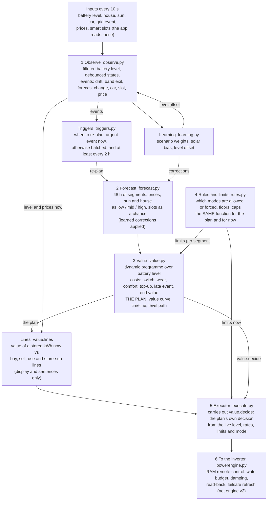
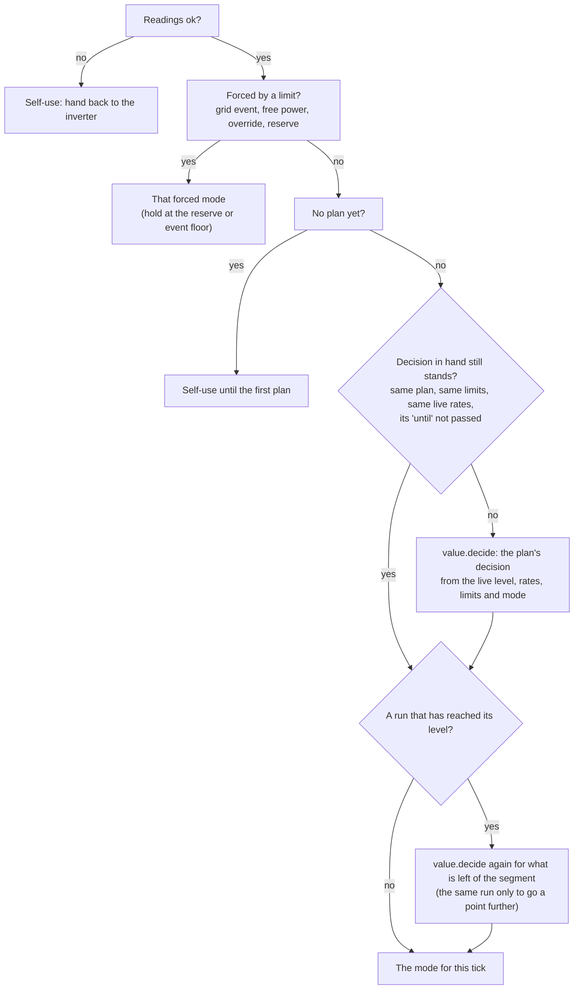

# Engine v2: how it is built, what runs where, and where each setting applies

10 Oct 2026 · the reference the ablation write-ups ([1](engine-v2-ablation-1.md), [2](engine-v2-ablation-2.md),
[3](engine-v2-ablation-3.md)) rest on. Written from the code (`apps/powerengine/pe_core/engine_v2/`), not from the design plan, so it
says what the engine does now. `engine-v2.md` is the design; where they differ, this page and the code are right.

## The one idea

Engine v2 does two different jobs, and most confusion comes from mixing them up.

1. **The model** works out, for the next 48 hours, *what a stored kWh is worth* at every battery level and every half-hour, given
   the prices, the sun, the house, the smart slots and the grid events. That is a dynamic program: it is solved backwards from the
   end of the 48 hours. It runs only now and then (a few dozen times a day, about a second each), not every tick. Its
   output is the **plan**: a table of values (`lam`), an expected timeline of modes, and an expected level path.
2. **The decision** (since 0.9.157 there is exactly one, `value._choose`) says what to do from a battery level, a mode running
   and the prices: which charge or sale to make and the level it runs to, else Self-use or Hold. The plan's expected timeline is
   that decision stepped forward over the forecast (`value._walk`); every 10 seconds the executor makes the same call from the
   live level, the live rates and the mode actually running (`value.decide`). The plan and the battery differ only where the
   inputs do.

Until 0.9.156 the live side was a second set of rules (the "lines" against the live prices, with price and level bands, a minimum
dwell, a turn-round levy and "a change must pay for itself") laid over the plan; the plan did not know they existed, so what it
showed and what the battery did drifted apart. Those rules are gone.

## Architecture

Read it as two loops:

- **The slow loop** (top, left to right): events arrive, the triggers decide a new plan is needed, the forecast is rebuilt, the
  value is solved. This is the *model*.
- **The fast loop** (every tick): the executor carries out the plan's decision, and makes it again from the live state when something
  changes (see below).

The hard limits (`rules.py`) and the decision (`value._choose`) are each one function used by both loops, so the plan and the live
decision cannot disagree about what is allowed or what to do.

## What is the model, and what is an adjustment

| Part | Where | What it is | Examples |
|---|---|---|---|
| **Model** | `forecast.py`, `value.py` | What is worth doing: it prices every option over 48 hours and every battery level. | prices, sun scenarios, wear, comfort band, top-up cost, late-event chance, end-of-horizon value, **switch cost inside the plan** |
| **Hard limits** | `rules.py` | What is allowed or forced. Facts and safety, not tuning. Used by the plan and by the live decision. | grid event, free power, manual override, car charging, reserve and hard floor, charge ceiling, BMS / fuse / cold caps |
| **Decision** | `value._choose`, `value.decide`, `execute.py` | The one decision: which run to make now and the level it runs to. The plan steps it forward; the executor calls it on the live state. | runs go to a level, not a time; the stretch's next run starts now; minimum run length (leg bands) |
| **When to re-plan** | `observe.py`, `triggers.py` | Decides when the model runs again. | drift, band exit, forecast change, batch window, backstop |
| **Data hygiene** | `observe.py` | Makes readings fit to act on. | debounces, stale-reading grace, the battery level filter |
| **Learning** | `learning.py` | Corrections that feed the forecast and the filter. | scenario weights, solar bias, level offset |

Why one decision: the ablations showed the live read, comparing one step at a time, chattered near a price line (1,743 mode changes
in three days with every adjustment off, ablation 2), and the adjustments that calmed it were invisible to the plan. With the plan's
own decision made live, the calm comes from the plan (the switch cost, the leg bands, runs that go to a level) and is the same in both.

## What happens in one tick (every 10 seconds)

1. The app reads the inputs and hands them to the engine (`_engine_tick`).
2. **Observe**: the battery level is filtered (energy counted, nudged toward the reading); readings are debounced; events are
   raised if something changed (a price boundary, a slot, a car start, drift from the forecast, the level leaving its expected range).
3. **Triggers**: if an event wants a new plan (and is urgent, or has waited the batch window, or the plan is two hours old), the
   engine re-plans now (see below).
4. **Lines**: from the current plan, the value of a stored kWh at this level and time is read out and set against the live import and
   export prices, after losses and wear (formulas below). They are shown and quoted in the sentences; they no longer choose the mode.
5. **Limits now**: `rules.limits_now` says which modes are allowed or forced right now.
6. **Executor**: carries out the decision in hand, or makes a new one (flow below).
7. The decision goes to the app, which sends it to the inverter under the write budget (not part of engine v2).

## What happens in one re-plan (a few dozen a day)

1. `forecast.build` cuts the next 48 hours into segments (every half-hour and at every price or slot edge) and attaches prices, events, the car and
   a low / mid / high figure for the sun and the house, with learned corrections applied. A smart slot is one *expected* price
   (its chance times the slot price plus the rest times the normal price), so the plan cannot count on a slot to refill what it sells.
2. `value.solve` runs the dynamic programme backwards over the segments and over battery levels (grid of `level_step_kwh`), against
   three net-load scenarios. For each level and segment it chooses the cheapest of Self-use, Hold, Charge and Export (with a partial
   charge or sale allowed), adding the **switch cost** whenever the mode changes from the previous segment, the wear, comfort and
   top-up costs, and (for unannounced grid events) the late-event chance. The end of the 48 hours is valued by `terminal_value`.
3. From the solved values it builds the plan: the value curve `lam[k][i]` (pence per stored kWh at segment k, level i), the expected
   **timeline** of modes with levels and reasons (the decision stepped forward, `_walk`), and the expected level **path** (mid, low
   and high).

## The lines (how the live read compares)

At level `L` and live prices, with `value` = what a stored kWh is worth now from the plan:

| Line | Formula | Meaning |
|---|---|---|
| buy | import / charge efficiency (+ top-up cost above the comfort band's top) | Charging pays while `value` > buy line |
| sell | export x discharge efficiency - `wear_sale_p` | Selling pays while `value` < sell line |
| use | import x discharge efficiency - `wear_house_p` | The battery should cover the house while `value` < use line |
| store sun | export / charge efficiency | Spare sun should be stored while `value` > store line |

When the value is above the buy line the live read wants to **charge**; below the sell line, to **sell**; between the lines it wants
Self-use or Hold. As the battery fills, `value` falls; as it empties, `value` rises. That is why the plan needs no separate "target
level" rules.

## The decision, and how the executor carries it out

`value._choose` decides, from a level, the mode running (and the charge or sale under way, for the leg bands) and the prices:

1. **The programme's own choice, over the rest of the stretch.** A *stretch* is the run of segments at one import price. The
   programme's own segment-by-segment choice (the backward pass's candidates and switch cost) is walked over what is left of it;
   that says which charges and sales pay at today's prices and the level each ends at (pieces of one mode with only idle time
   between them are one run).
2. **The first run, now, to its level.** If the programme starts a run now, it goes to where that run ends, however many segments
   it takes. If the programme would idle now and start a run later in the stretch, the run starts now and the idle time comes
   after it (at the same prices the order is free, and the forecast moves: smart slots come and go).
3. **Charge early.** A charge anywhere in the stretch starts now, at full power, to the level the programme reaches by the
   stretch's end, up to the top of the free range (the comfort band's top, or where the top curve starts).
4. **Leg bands.** A charge or a sale runs at least the span between the level bands (`level_bot_start_soc` to
   `level_top_start_soc`, cut short by the band's edge in its direction) before it may stop or turn round; a new run's level
   includes it.
5. **Otherwise idle**: the programme's own Self-use or Hold (Hold only where the rules allow it).

`value._walk` steps this forward: a run goes on across segments until it reaches its level or its stretch ends; reaching the level
brings the next decision at once, inside the segment; idle time is decided again at each segment (sun and house change there). The
executor does exactly that at the live level:

- "Until": a run's decision stands until its stretch ends; an idle decision until its segment ends.
- The current segment is priced at the **live** rates, without slot odds (a slot running now is certain, and a new rate can arrive a
  moment before its segment). With under a minute left of a segment, the decision is made for the next one.
- One tolerance for "at its level" (`value.LEVEL_TOL_PCT`, 0.1 point) in both the plan and the executor.
- Not shown: the **deadline** (a run that outlasts the plan's expected end by `DEADLINE_GRACE_MIN` asks for a new plan; it never stops
  the run) and the flip-flop count for the health sensor.

## How the simulator touches each part

| What the simulator changes | How | Parts it reaches |
|---|---|---|
| An engine setting | Put into the config's `engine_v2:` block, read by the real app | Anything in the tables below |
| A module constant | `setattr` before the run | The tuning with no setting (`COARSE_STEP_KWH`, `LEVEL_EPS` and so on) |
| A rule that is code | The method is replaced by a neutral stub (`@false`, `@true`, `@pass`) | none left in the executor since 0.9.157 |

Nothing in the repo's engine code changes. A setting set to "off" in the GUI is the same as the config page setting it to that value.

## Every setting, what it does, and where it is applied

Since 0.9.157 the settings say **what you want**, and each maps onto the engine's own tuning (the properties of `V2Settings`
in `settings.py`). Every one acts in the plan and the live decision alike, because the live decision is the plan's. Kinds:
**LIMIT** a hard rule (`rules.py`); **MODEL** what the plan thinks is worth doing; **WHEN** when to re-plan; **DATA** filters
readings; **LEARN** learns a correction; **APP** not part of how the engine decides. "2.2 beta" is the profile's value where it
differs from the default.

### What the battery may do

| Setting | Default | 2.2 beta | Kind | What it does (engine tuning it sets) |
|---|---|---|---|---|
| `arbitrage` | off |  | LIMIT | Whether Export is a mode at all. |
| `events`, `event_value_p`, `event_plus_export` | on, 100p, on |  | LIMIT, MODEL | Act on grid events; what one pays; whether the export rate is paid on top. |
| `free_power`, `free_arbitrage` | on, off | on, **on** | LIMIT | Act on free-power sessions; may they also sell. |
| `hold_use` | cheap times | **car and reserve** | LIMIT | When Hold is allowed: only for the car and the reserve (`hold_only_car_reserve`), also at cheap times (`prefer_self_use`), or any time. |
| `charge_ceiling_soc` | 100 % |  | LIMIT | The highest level a grid charge reaches. |
| `charge_max_import_p` | 0 (off) | **15p** | LIMIT | No grid charge above this import price. |

### The battery's range

| Setting | Default | 2.2 beta | Kind | What it does (engine tuning it sets) |
|---|---|---|---|---|
| `reserve_soc` | 12 % | (yours: 15) | LIMIT | Kept back in normal running. |
| `range_low_soc` | 20 % | **70** | MODEL | Where the bottom curve starts (`level_bot_start_soc`): below it keeping energy costs by the hour. |
| `range_high_soc` | 90 % | 90 | MODEL | Where the top curve starts (`level_top_start_soc`); also where a charge stops being free to start early. |
| `range_firmness` | gentle | **firm** | MODEL | The curves' rates (`FIRMNESS_CURVES`: off 0/0, gentle 50/3p, firm 200/10p, strict 500/50p, top at 100% / bottom at the reserve, p per kWh per hour). |
| `min_run_pct` | 0 (off) | **5** (20 until 0.9.158) | MODEL | Shortest charge or sale, cut short by the range's edge (`value.leg_band`, `leg_need`). Before 0.9.157 it was implied as the span between the two curve starts. |
| `slot_floor_soc` | 0 (off) | **80** | MODEL | While a smart slot is counted on, the bottom curve starts here at 30 times the rate (`slot_bot_start_soc`, `SLOT_BOT_FACTOR`). |
| `slot_odds_pct` | 60 % | (yours: 90) | MODEL | The chance of a smart slot outside the overnight window (was the shared `smart_slot_certainty_pct`, which seeds it). |

### Trading

| Setting | Default | Kind | What it does |
|---|---|---|---|
| `switch_cost_p` | 2.0 p per change | MODEL | The one price of changing mode. Higher: fewer changes, less profit. |
| `wear_p` | 0.0 p/kWh | MODEL | Counted on each kWh the battery gives out, to the house or sold (`wear_house_p`, `wear_sale_p`). |

### Forecast

| Setting | Default | Kind | What it does |
|---|---|---|---|
| `forecast_caution` | balanced | MODEL | What a sale while energy is dear keeps for the house until energy is certainly cheap again (`value._keep_kwh`; a smart slot that may not come is not cheap): optimistic nothing, balanced the forecast's middle case, cautious the high house and low sun (0.9.158; before, the starting weights, which learning overrode). |
| `learn` | on | LEARN | Learn the weights and the solar forecast's bias. |

### Advanced

`hard_floor_margin_pct` (LIMIT: a grid event stops this far above the hard floor), `learn_soc_offset`, `scenario_half_life_days`,
`scenario_prior_days` (LEARN), `car_start_debounce_s`, `car_stop_debounce_s`, `stale_after_s`, `soc_filter_gain` (DATA),
`price_churn_hold_s` (WHEN), `sample_s`, `preview_when_v1` (APP).

Retired in 0.9.157 and carried over where a new setting means the same (`settings._migrate`): the comfort band
(`comfort_low_soc`, `comfort_high_soc`, `comfort_cost_p`, `top_up_cost_p`: their code is gone; the range does the job), the six
`level_*` curve settings, `slot_bot_factor` and `slot_bot_start_soc`, `prefer_self_use` and `hold_only_car_reserve`, `wear_house_p`
and `wear_sale_p`, the six starting weights and the two learning switches.

### Constants since 0.9.156 (no longer settings)

Replays of 8 to 15 Oct 2026 showed these settings changed nothing measurable, so they are no longer settings: a saved value is
ignored, and the number lives in the module named below (the simulator can still change it as `engine_v2.<module>.<NAME>`).

| Constant | Value | What it does |
|---|---|---|
| forecast.py `MAX_SEGMENT_MIN` | 30 min | No step of the look-ahead is longer than this (above 30 changes nothing: steps are already half-hours). |
| observe.py `FORECAST_CHANGE_PCT` | 10 % | A forecast update that moves the rest of today's sun by this much asks for a new plan. |
| observe.py `DRIFT_KWH` | 0.75 kWh | The house differing from the forecast by this much asks for a new plan. |
| observe.py `BAND_EXIT_MIN` | 10 min | The battery outside the plan's expected range this long asks for a new plan. |
| triggers.py `REVALUE_COALESCE_S` | 10 s | Reasons for a new plan that arrive this close together run once. |
| triggers.py `MAX_VALUE_AGE_MIN` | 120 min | A new plan at least this often, in case a trigger was missed. |
| execute.py `DEADLINE_GRACE_MIN` | 10 min | How long a run may pass its expected end before a new plan. |
| rules.py `LEVEL_BAND_PCT` | 1 point | Once held at the reserve, the level must rise this far before discharging resumes; a forced charge restarts this far under its ceiling; the expected-range trigger is widened by it. |
| observe.py `DEBOUNCE_S` | 20 s | A changed reading must last this long to count. |
| value.py `LEVEL_STEP_KWH` | 0.1 kWh | The battery-level grid the values are worked out on. |

Removed outright (their code is gone): `replan_on_level` (a charge or sale reaching its level no longer asks for a re-plan; the
results were identical), `reentry_levy_p` (the 10-minute restart levy changed two days and no mode changes), and `terminal_value` /
`terminal_value_p` (the energy left at the end is always valued by the refill rule; `value.TERMINAL_FIXED_P` stays only so tests and
the simulator can fix it).

Removed in 0.9.157, with the second set of live rules (one decision for the plan and the executor): `executor` (there is one way),
`price_band_p`, `level_band_pct` (now `rules.LEVEL_BAND_PCT` where it still matters), `min_dwell_s` and `reversal_levy_p`. Replays of 8 to
16 Oct: the one decision earned £0.87 more than 0.9.156 over the nine days with the same number of flip-flops; a minimum time of 2, 5 or
10 minutes and a turn-round price of 5 or 10p, each in the shared decision, all cost money.

## The rules that are code (no setting)

| Rule | In | What it does | In the plan? |
|---|---|---|---|
| Runs go to a level | `value._choose`, `_walk`, `execute._follow` | A charge or sale goes on, across segments, until its level or its stretch ends; reaching the level brings the next decision at once. | Yes (it is the plan) |
| The stretch's next run, now | `value._choose` | At one price the order is free: a run starts now and the idle time comes after it. | Yes |
| `RESTART_PCT` (1 point) | `value._choose`, `_walk` | A run that has just reached its level starts again only to go this much further. | Yes |
| `LEVEL_TOL_PCT` (0.1 point) | `value.py`, `execute.LEVEL_EPS` | A run "has reached its level" within this, in both. | Yes |
| `SLIVER_S` (60 s) | `value.decide` | With less than this left of a segment, the decision is for the next one. | Not needed (the plan has no slivers) |
| `reserve_latched` | `execute.py`, `rules.py` | Once held at the reserve, no discharge until the level is `LEVEL_BAND_PCT` above it. | No (a limit) |

## Engine 2.1 beta (0.9.136)

Engine 2.1 beta is **engine v2 with a different executor and two level limits, chosen on the config page** (`system.engine: v2_1`).
The app treats it as engine v2 everywhere (`sensor.pe_state_engine` still says `v2`, with an attribute `choice`), so the plan, the
sensors, the history and the control path are the same. What differs:

| Part | Engine v2 defaults | Engine 2.1 beta profile |
|---|---|---|
| Which mode now | the one decision (since 0.9.157; before, `executor: lines` or `plan`) | the same |
| Top and bottom of the battery | the comfort band and the top-up cost | exponential curves in the plan (`level_top_*`, `level_bot_*`), sharper bottom inside smart slots (`slot_bot_*`) |

It has no separate settings block: it is a profile of the `engine_v2:` settings (`BUILTIN_PROFILES` in `settings.py`). Since
0.9.157 "2.1 beta" is a firm 70 to 90% range, a shortest run of 20 points and an 80% slot floor, with Hold any time; "2.2 beta"
adds Hold only for the car and the reserve, free power that may sell, and the 15p charge cap.

## Things worth being clear about

- **Every setting acts in the plan and live alike** (0.9.157): the executor makes the plan's decision, so there is no live-only
  tuning left. The remaining live-only things are limits (`rules.limits_now` from live readings) and data hygiene.
- **Settings the simulator cannot judge.** `late_events*` insure against events announced at short notice; a replay holds only the
  events that happened. `debounce_s`, `car_*_debounce_s`, `stale_after_s` and `soc_filter_gain` exist for noisy live readings; the
  simulated readings are clean, so removing them would look free and is not.
- **Not engine v2.** What happens after the decision (RAM remote control, the write budget, damping, read-back, the five-minute
  failsafe) is the app's control layer; none of the settings above apply there.
- **What I did not verify by running it:** the interaction of the adjustments when several are removed (the ablations measure it, but I
  have not traced why, for example, removing four "second prices" saves less than removing two). The table is read from the code.
